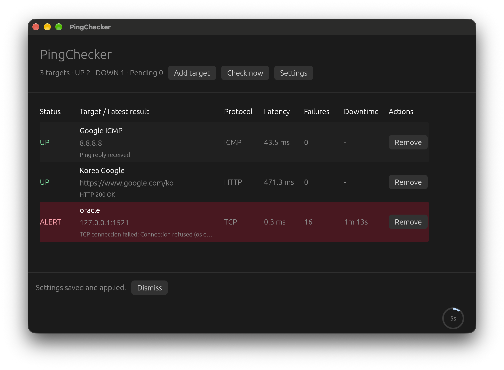

# PingChecker

A native desktop app that monitors ICMP, TCP and HTTP targets and beeps when one goes down.



## Download

Download the archive for your OS and architecture from the
[latest release](https://github.com/found-cake/PingChecker/releases/latest).
Extract it and run `pingchecker` (`pingchecker.exe` on Windows).

The default build requires OpenGL 2.0+. If your system doesn't support it,
choose the matching `-wgpu` archive when available.

Settings and targets are saved to `ping.yml` beside the executable.
See `ping.example.yml` for the format.

## Features

- ICMP ping (using the system `ping` command), TCP connect and HTTP GET (2xx) checks
- Latency, consecutive failures and downtime per target
- Beep after N consecutive failures; the alerted row stays red until it recovers
- Light / Dark theme, countdown to the next check

## From source

### Build

```sh
# OpenGL 2.0+
cargo build --locked --release

# wgpu
cargo build --locked --release --features wgpu
```

### Run

```sh
# OpenGL 2.0+
cargo run --locked --release

# wgpu
cargo run --locked --release --features wgpu
```
